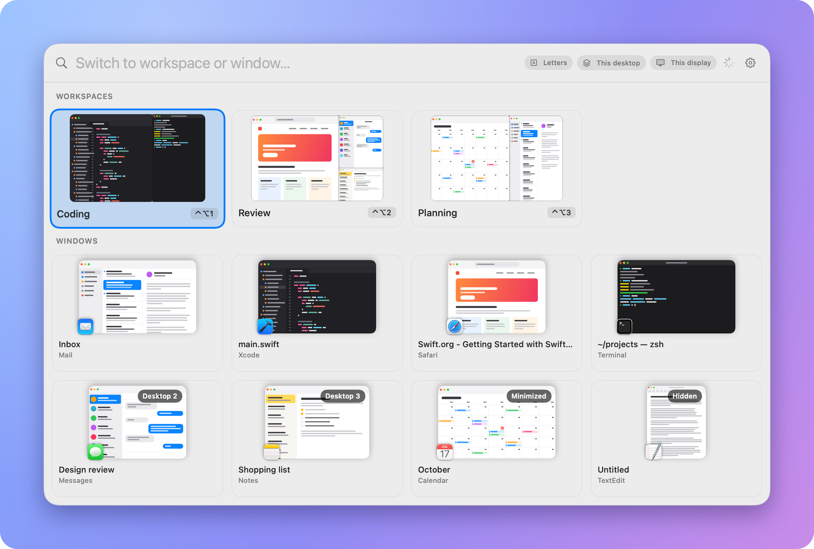
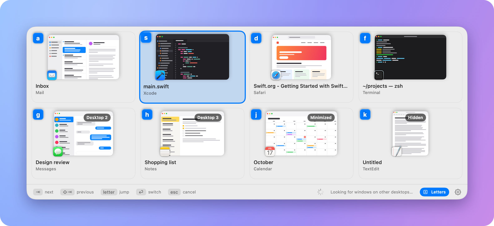
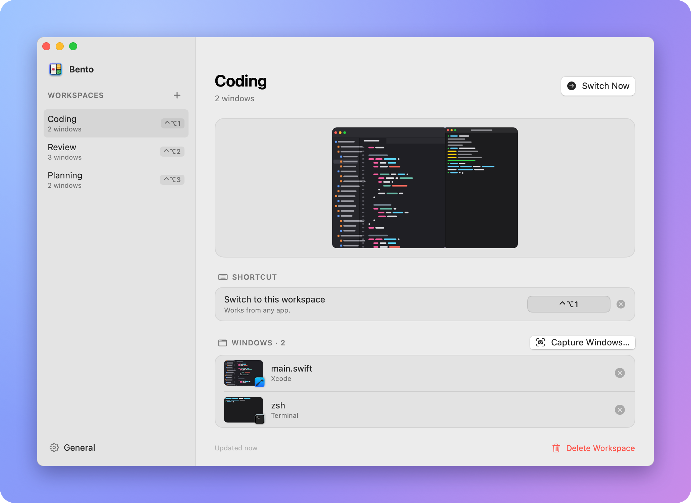

# Bento

A macOS menu bar app that saves groups of windows as **workspaces** and brings a whole workspace forward in one
step: each window goes back to its position and size, and only those windows are raised, even when an app has many
others open. It also has an AltTab-style **window switcher** (⌥Tab) for jumping to any window on any desktop.
Up to 0.2.0 it was called Oh my windows. Updating keeps your workspaces, settings and permissions.



This repository holds the releases only.

## Install

```sh
brew install --cask tuanchauict/tap/bento
```

Or download the zip from [Releases](../../releases), unzip it and move **Bento.app** to Applications.
Needs macOS 14 or later. Builds are signed and notarized, and run on Apple silicon and Intel.

## Permissions

- **Accessibility** (System Settings > Privacy & Security > Accessibility) is required: it is how windows are found,
  moved and raised.
- **Screen Recording** (Screen & System Audio Recording) is optional. It gives the switchers a preview of each
  window; without it they show app icons. macOS may ask you to reopen the app after you allow it.

## Using it

1. Arrange the windows you want: positions, sizes, which is on top.
2. Menu bar icon > **New Workspace from Current Windows…**, tick the windows, **Save**.
3. Switch with the menu, a per-workspace shortcut, or the quick switcher (**⌃⌥Space**). Typing in the quick
   switcher filters workspaces by name and windows by app or title.

Hold ⌥ and press Tab for the window switcher, Tab again to move on, and let go of ⌥ to jump to the highlighted
window. It lists the windows of every desktop, most recently used first, and marks the ones on another desktop,
minimized or hidden.

Click **Letters** on either switcher and every card gets a letter: type it to switch. The quick switcher then opens
on the letters, with / to search. The gear on the switchers opens their settings.



Settings are under menu bar icon > **Manage Workspaces…**: each workspace's layout, shortcut and windows. Finding
windows on other desktops, and jumping to them, uses the **Enhanced** raise method (the default), which relies on
private macOS calls as AltTab and yabai do.



## Update and uninstall

```sh
brew upgrade --cask bento
brew uninstall --cask bento    # add --zap to also remove saved workspaces and caches
```
